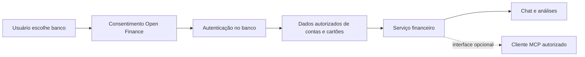

# Conexões bancárias, Pierre e MCP

Pesquisa pública em **17/10/2026**. Nenhum cadastro, consentimento, conector ou
pagamento foi executado na pesquisa. Depois, Enzo autorizou o experimento pessoal
separado Meu Pluggy, descrito em `17-MEU-PLUGGY-PESSOAL.md`, ainda sem prova real.
O SaaS continua usando importação de arquivos e lançamentos confirmados.

## Como o Pierre conecta

A [landing de conversa do Pierre](https://lp.pierre.finance/lp/converse) descreve
autorização no aplicativo do banco por Open Finance, sem entregar a senha ao
Pierre. O assistente consulta as informações e declara não fazer pagamentos ou
transferências. A conexão do plano gratuito é limitada a um banco.

Os [termos oficiais, seção 3.4](https://pierre.finance/privacy-policy) também
descrevem integração Open Finance e acesso estruturado por REST/MCP. Essa menção
não documenta o endereço, autenticação, ferramentas ou disponibilidade do MCP em
cada plano. Não encontrei um manual público de conexão que permita validar esse
fluxo. Não é evidência de controle da tela dos aplicativos bancários.

A [central de ajuda do Pierre](https://ajuda.pierre.finance/pt-BR/articles/16035238-como-resolver-problemas-de-conexao-open-finance)
adverte que bancos podem não aparecer, a sincronização pode atrasar e o
consentimento precisa ser renovado ao vencer. Portanto, atualização automática
não equivale a informação instantânea garantida. As fontes consultadas não
identificam um agregador contratado pelo Pierre; não presumimos Pluggy ou Belvo.

Esse diagrama resume o fluxo público, sem afirmar como o backend do Pierre foi
implementado. MCP é uma interface adicional; a origem dos dados continua sendo
o banco e a autorização concedida.

## O que significa conectar um MCP

Na [arquitetura oficial MCP](https://modelcontextprotocol.io/docs/learn/architecture),
o cliente conversa com um servidor que expõe ferramentas e dados. O protocolo
sozinho não concede acesso a contas bancárias nem permite abrir aplicativos
privados do iPhone a partir do Windows.

| Possibilidade | O que resolve | Situação no Tato |
| --- | --- | --- |
| Servidor MCP do Tato | Consultar dados já importados usando outro assistente | Viável tecnicamente, ainda não implementado; exige autenticação, isolamento e política para o cliente de IA |
| Cliente MCP dentro do Tato | Chamar um fornecedor com ferramentas documentadas | Depende de contrato, consentimento, preço e revisão do provedor |
| MCP que lê documentação | Ajuda a programar integrações | Não importa extratos pessoais por si só |
| Controle do aplicativo bancário no celular | Automatização da interface | Não demonstrado nesta combinação iPhone/Windows; não substitui Open Finance |

O [MCP da Pluggy](https://docs.pluggy.ai/en/docs/developer-tools/mcp) oferece
documentação pública sem autenticação. Com login, também oferece ferramentas do
portal de desenvolvimento, como itens, conectores e diagnóstico, restritas à
equipe. Não devemos confundir esse portal com uma autorização universal para
ler transações de qualquer titular. A API de produto usa credenciais próprias.

## Conta, cartão e Pix são acessos distintos

Consultar um Pix enviado ou recebido é **ler uma movimentação**. Iniciar um Pix
é **ordenar um pagamento**. O [Banco Central](https://www.bcb.gov.br/meubc/faqs/s/open-finance)
distingue compartilhamento de dados e iniciação de pagamentos e informa que os
participantes diretos são instituições autorizadas. Um SaaS não obtém uma licença
por instalar um MCP. Uma integração por parceiro tem condições próprias.

O Tato pode importar movimentações disponibilizadas em arquivo. Não possui
iniciação de Pix. Se uma fonte trouxer apenas o pagamento da fatura, isso não
revela as compras individuais do cartão. Cartão e conta precisam ser conferidos
separadamente; o pagamento da fatura não pode duplicar as compras nos totais.

## Bancos pedidos por Enzo

A [cobertura publicada pela Pluggy](https://docs.pluggy.ai/en/docs/open-finance/institutions-coverage)
lista **PicPay PF** e **Sicoob PF/PJ** com contas, transações e cartões. A própria
tabela agrega contextos diferentes: isso não garante todos os produtos de um
titular específico. Banestes não aparece na tabela consultada. Isso não prova
que esteja ausente de todos os fornecedores ou do Pierre.

| Instituição/produto | Evidência pública | O que ainda precisa ser provado |
| --- | --- | --- |
| PicPay conta e cartão | Cobertura genérica Pluggy | Produto e dados liberados no consentimento real |
| Sicoob conta | Cobertura genérica Pluggy | Cooperativa, contexto PF e completude das movimentações |
| Sicoobcard | Sicoob tem cartões na cobertura genérica | Cartão exato e compras/faturas acessíveis pelo conector; não há prova obtida |
| Banestes/Banescard | O [RI Banestes](https://ri.banestes.com.br/docs/Relatorio-de-Sustentabilidade-banestes-2022-12-31-fjNTNGbR.pdf) confirma adesão ao Open Finance | Fornecedor, instituição transmissora e produtos efetivamente disponíveis |

Não confundir Banestes com Banrisul. A existência de Open Finance no banco não
garante que um agregador específico ofereça aquele banco ou aquele cartão.

## O que cabe em R$ 0

Há uma alternativa nova para **uso exclusivamente pessoal**, distinta do SaaS:
o [guia oficial Meu Pluggy](https://docs.pluggy.ai/en/docs/guides/meu-pluggy-personal-use)
permite acessar os próprios dados pela API com até **cinco conexões**, sem uso
comercial e sem depender da duração do teste. O usuário conecta os bancos no
Meu Pluggy e autoriza o conector MeuPluggy no Dashboard. A sincronização ocorre
a cada 24 horas; não há atualização manual. Os dados são reais, não sandbox.

Isso permite propor um experimento separado para Enzo, após aprovação do novo
provedor e verificação da cobertura. Não autoriza oferecer conexão gratuita a
todos os usuários do Tato. Usar somente o caminho Open Finance consentido;
qualquer conector que solicite senha bancária exige uma análise distinta.

Os [preços atuais da Pluggy](https://www.pluggy.ai/precos) diferenciam uso pessoal
e produto comercial: Dados parte de R$ 2.500/mês, com teste de produção de 15 dias.
Um teste temporário não atende ao requisito de SaaS permanentemente gratuito.
O FAQ de preços diz que o proxy MeuPluggy pode tecnicamente acessar dados
autorizados. Isso não revoga a restrição explícita de uso pessoal e não comercial
do guia. Não interpretamos possibilidade técnica como autorização de SaaS gratuito;
qualquer divergência precisa ser esclarecida com o fornecedor antes de adotá-lo.
A [Belvo](https://belvo.com/plans-and-pricing/) também distingue sandbox gratuito
de produção paga. Não habilitaremos trial com contas reais como solução permanente.

Recomendação: manter arquivos e prévia no MVP; testar a CLI pessoal Meu Pluggy
separada descrita em `17-MEU-PLUGGY-PESSOAL.md`; só depois avaliar conexão comercial. Um servidor MCP do
Tato pode reutilizar as consultas existentes, mas não elimina o custo de obter
dados bancários. O experimento local não é um botão de conexão do SaaS nem uma
integração bancária comprovada; depende de consentimento e testes reais.
